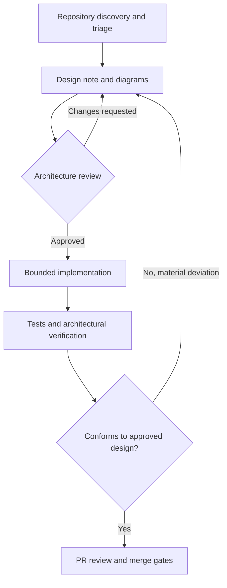

# System Design First: Architecture Design Gate

Status: repository governance guidance. Applies to maintainers, contributors and coding agents.

## Principle

**Discover -> Design -> Review -> Approve -> Implement -> Verify.** Do not implement a non-trivial feature or architectural change before its design is documented and approved. This is an additional gate, not a replacement for `AGENTS.md`, canonical task triage, RFC/ADR approval, or the feature acceptance gate.

## 1. Discover current truth

Read `AGENTS.md`, `PROJECT_STATE.md`, the latest `DUTY_WATCH.md` entry, relevant architecture documents, RFCs/ADRs, source code, tests and consumers. Run `docs/governance/AGENT_TASK_TRIAGE_POLICY.md` and record its verdict. Distinguish implemented, accepted, experimental and proposed components; never draw future modules as already shipped. Capture the problem, users, acceptance criteria, constraints and non-goals. Resolve ambiguous domain vocabulary using `DOMAIN_DRIVEN_ARCHITECTURE.md`.

## 2. Create a design artifact

For a non-trivial change, create `docs/designs/<task-slug>/DESIGN.md` (or link an existing accepted RFC/architecture document with equivalent coverage). Include:

1. Status (proposed / approved / superseded), owner, date, relevant issue and RFC/ADR links.
2. Problem, use cases, functional and non-functional requirements, scope and non-goals.
3. Current-state evidence, affected packages/consumers, dependencies and public boundaries.
4. C4 context/container/component views **as applicable**, with legend and explicit proposed versus existing elements.
5. Sequence/data-flow/state diagrams for meaningful interactions, lifecycle, failure, cancellation, disposal or persistence transitions.
6. DDD context ownership, ubiquitous terms, invariants, dependency direction and ports/adapters; tactical patterns only where justified.
7. Typed API/contract sketches, input/output schemas, error semantics, compatibility and migration implications.
8. Alternatives and trade-offs, security/privacy, SSR/platform support, accessibility, performance/bundle/memory and observability considerations as relevant.
9. Verification matrix mapping each acceptance criterion and risk to tests, fixtures, benchmarks or manual evidence.
10. Open questions, risks, rollback, implementation slices and explicit approval record.

Prefer Mermaid in Markdown for diffable diagrams; `.mmd` files may be used for large diagrams. Diagrams must name the contracts across boundaries, not just boxes. Do not assume a package is a bounded context. Keep the design proportional to the blast radius; a short diagram and design note can suffice for a focused change.

## Diagram tooling and canonical storage

For each new or materially changed design, keep the **editable source** in `docs/designs/<task-slug>/`, with a linked `DESIGN.md` or accepted RFC/ADR. The existing `docs/architecture/designs/` directory remains an index and home for legacy records; do not duplicate or relocate accepted historical designs solely for this policy. New diagrams live in `docs/designs/` even when the main design decision is recorded elsewhere.

Choose one or combine several formats based on the design question. **All three are not required**:

| Format | Use for | Committed files |
| --- | --- | --- |
| Excalidraw | architecture sketches, wireframes, collaborative visual exploration | `*.excalidraw` editable JSON **and** matching `*.svg` preview |
| diagrams.net / draw.io | detailed component, integration, network and deployment views | `*.drawio` editable XML **and** matching `*.svg` preview |
| Mermaid | sequence, flowchart, state, data-flow and text-reviewable architecture diagrams | `*.mmd` or fenced `mermaid` in `*.md`; SVG optional |

Use matching basenames, for example `components.drawio` and `components.svg`. Exports must accurately reflect the editable source. Keep SVGs reviewable and self-contained; avoid embedded scripts, external network resources, secrets or personal data. SVG is a preview, **not** the editable source. Reviewers must be able to open and modify the native file without a proprietary export step. Do not commit binary-only diagrams in place of source files.

A recommended structure:

```text
docs/designs/<task-slug>/
  DESIGN.md
  architecture.excalidraw
  architecture.svg
  deployment.drawio
  deployment.svg
  sequence.mmd
```

Only include files relevant to the task. `DESIGN.md` links each diagram and records purpose, source-of-truth status, existing versus proposed components, affected DDD bounded contexts, contracts and approval evidence. A design that uses only Mermaid may contain just `DESIGN.md` with fenced diagrams. When design lives in an accepted RFC/ADR, use `docs/designs/<task-slug>/README.md` as a lightweight pointer to the decision and diagram sources rather than copying the decision text.

During architecture review, inspect both native sources and rendered previews, verify that labels, arrows, dependency direction, DDD ownership, security boundaries, error paths and deployment assumptions match repository reality. Check source/preview synchronization. If a diagram changes materially after approval, request renewed approval before implementation.

## 3. Review and approval gate

Review the proposed design against small-core/YAGNI, `DOMAIN_DRIVEN_ARCHITECTURE.md`, `CODE_QUALITY_STANDARDS.md`, RFC/ADR policy, public API stability and applicable security/privacy rules. The design must identify a concrete consumer for any new abstraction. **Stop before production implementation** until the project owner explicitly approves the design (or an existing accepted design clearly covers the exact scope). Record the approval in the design document, linked issue or PR. Approval of a design does not implicitly authorize unrelated changes, publication or releases.

## 4. Implementation handoff

An implementation task must link the approved design and approval evidence, identify a bounded slice, relevant source files, acceptance criteria, verification commands and stop conditions. The coding agent must read the design and applicable governance before changing code. Any material departure from the approved contracts, dependencies or diagrams requires a design update and renewed review before proceeding.

## 5. Verification and merge

Review the complete diff against the approved diagrams and acceptance matrix. Execute relevant checks and repository CI; report commands and outcomes accurately. Check public API compatibility, lifecycle/disposal, SSR, dependency direction, regression and security/privacy impacts as appropriate. Update diagrams and decision records to reflect the final implementation. Follow `FEATURE_ACCEPTANCE_GATE.md`, `CONTRIBUTING.md`, and duty-watch/project-state update rules. No unverified claim of passing checks.

## Lightweight exceptions

Typo fixes, formatting-only edits, straightforward documentation corrections and tightly scoped bug fixes with an established design do not need a new full C4 suite or separate approval ceremony. They still require task triage, inspection of relevant architecture, a short design/impact note when useful, and applicable verification. A bug whose fix changes contracts or architectural boundaries uses the full gate.

## Example: proposed design workflow



This workflow diagram is normative for the **process**, not a claim about existing runtime components.
