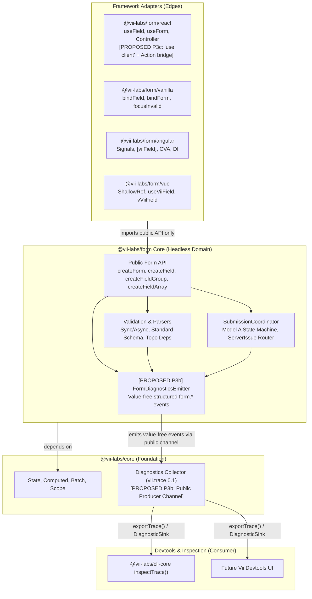

# Vii Form Phase 3 — Discovery & System Design (P3a)

- **Status:** Proposed (Architecture & Design First — **not** authorized for implementation)
- **Owner:** Kas Labs / Vii Maintainers
- **Date:** 2026-11-15
- **Slice:** P3a (Phase 3 Discovery & System Design)
- **Target Package:** `@vii-labs/form` (`packages/form/`) and bounded diagnostics contract in `@vii-labs/core` (`packages/core/`)
- **Authoritative Baselines:**
  - [FORM_ARCHITECTURE.md](../../architecture/FORM_ARCHITECTURE.md) (Phase 1 baseline)
  - [FORM_PHASE2_ARCHITECTURE.md](../../architecture/FORM_PHASE2_ARCHITECTURE.md) (Phase 2 P2a–P2h)
  - [FORM_RELEASE_GATE.md](../../release/FORM_RELEASE_GATE.md) (Stage A2 Preview readiness)
  - [DIAGNOSTICS_PROTOCOL.md](../../architecture/DIAGNOSTICS_PROTOCOL.md) (`vii.trace` `0.1` protocol)
  - [DOMAIN_DRIVEN_ARCHITECTURE.md](../../architecture/DOMAIN_DRIVEN_ARCHITECTURE.md)
  - [SYSTEM_DESIGN_GUIDELINES.md](../../architecture/SYSTEM_DESIGN_GUIDELINES.md)
  - [ARCHITECTURE_PREFLIGHT.md](../../governance/ARCHITECTURE_PREFLIGHT.md)

> [!IMPORTANT]
> **Approval Gate:** This document is a **proposed architecture** for Vii Form Phase 3. It does **not** authorize production code implementation, public API changes, dependency additions, Changeset consumption, version bumps, or npm publication. Implementation of any Phase 3 slice requires explicit owner approval of this design.

---

## 1. Task Triage & Architecture Preflight

### 1.1 Canonical Task Triage

```text
Triage 8/10 (radius 2 · ambiguity 2 · risk 1 · verify 1 · unknowns 2)
Harness: Antigravity · Model: Gemini 4 Hydrogen (Medium) · Effort: high
Delegation: none · Grilling: no (discovery/design artifact only; owner approval gate follows) · Skills: none
Context/load code: AGENTS.md, ROADMAP.md, PROJECT_STATE.md, DUTY_WATCH.md, FORM_ARCHITECTURE.md, FORM_PHASE2_ARCHITECTURE.md, FORM_RELEASE_GATE.md, DIAGNOSTICS_PROTOCOL.md, packages/form/src/**, packages/core/src/diagnostics.ts
Approval: explicit owner approval required before any Phase 3 implementation slice
Budget: documentation-only PR on docs/form-p3a-system-design · Stop when: DESIGN.md, DUTY_WATCH.md, validation checks, and PR are ready for review
```

*Smallest change to lower the score:* Narrowing Phase 3 evaluation to a single candidate (e.g., Form Diagnostics only) would reduce ambiguity and unknowns from 2 to 1.

### 1.2 Architecture Preflight

```text
Architecture Preflight

Task: Vii Form Phase 3 Discovery & System Design (P3a)
Bounded context / owner: Form (packages/form), with cross-context boundary to Diagnostics (@vii-labs/core) and Framework Adapters (React, Angular, Vue, Vanilla)
Canonical architecture sources:
- docs/architecture/FORM_ARCHITECTURE.md
- docs/architecture/FORM_PHASE2_ARCHITECTURE.md
- docs/architecture/DIAGNOSTICS_PROTOCOL.md
- docs/architecture/DOMAIN_DRIVEN_ARCHITECTURE.md
- docs/release/FORM_RELEASE_GATE.md
Relevant RFC / ADR:
- Accepted Phase 2 ADRs P2-1 through P2-7 (in FORM_PHASE2_ARCHITECTURE.md)
- Proposed Phase 3 ADRs P3-1 through P3-4 (in Section 6 of this document)
- Note: Core Diagnostics public producer contract changes require RFC/ADR alignment per CONTRIBUTING.md
Ubiquitous language: FieldState, FieldGroup, FieldArray, FormInstance, RawValue, DomainValue, ParseIssue, ValidationIssue, ServerIssue, SubmissionStatus, Scope, Diagnostics, DiagnosticTrace (vii.trace 0.1)
Dependency direction: Framework Adapters -> Public Form API -> Form Domain Modules -> @vii-labs/core (State, Computed, Batch, Scope, Diagnostics)
Public API impact: None in P3a (docs only). Proposed Phase 3 slices add additive subpath/diagnostic APIs while preserving Preview compatibility.
Security / trust boundary: Value-free diagnostics privacy (no domain/raw values or server error messages in traces); plain-text DOM sinks; fail-closed Standard Schema & ServerIssue path routing; Angular 17.3.12+ peer safety.
Lifecycle concerns: Scope ownership/disposal, AbortSignal cancellation, React 19 concurrent/Action transitions, Angular DestroyRef/DI teardown, 0 retained subscriptions/scopes/timers.
File-size budget: <=250 preferred; review >300; >400 requires approved exception (for future implementation slices)
Function-size budget: <=40 preferred; >80 requires approved exception (for future implementation slices)
Required verification: git diff --check, pnpm format:check, pnpm lint, pnpm typecheck, pnpm --filter @vii-labs/form test, pnpm validate
Unresolved architecture decisions: Listed in Section 11 (requiring owner decision before P3b implementation).
```

---

## 2. Current Repository Truth & Phase 2 Baseline

### 2.1 Confirmed Package & Merge Status

- **P2h Merge Confirmed:** `e790a4f` (`docs(form): complete Phase 2 graduation review (P2h) (#202)`) is merged on `main`.
- **Package Identity:** `@vii-labs/form` (`packages/form/package.json`), version `0.1.0-experimental.1`, `"private": true`, `vii.stability: "preview"`, `"sideEffects": false`, pure ESM.
- **Publication Status:** Unpublished. `.changeset/preview-form-candidate.md` remains unconsumed. Publication is governed separately by Stage B in [FORM_RELEASE_GATE.md](../../release/FORM_RELEASE_GATE.md).
- **Public API Surface (`packages/form/api-surface.json`):** 35 runtime exports and 93 public named types across 5 preview entrypoints:
  - `.` (root): 7 runtime exports / 50 public types
  - `./react`: 7 runtime exports / 12 public types
  - `./vanilla`: 4 runtime exports / 9 public types
  - `./angular`: 8 runtime exports / 9 public types
  - `./vue`: 9 runtime exports / 13 public types
- **Verification Baselines (P2h):**
  - 510 Form unit tests passing.
  - Cross-browser matrix: 138/138 passing (46/46 per engine across Chromium, Firefox, WebKit; 0 Axe WCAG 2.2 AA violations).
  - Performance & bundle gate: 41/41 HARD gates passing (`createFieldOnly` 15,997 B min / 4,589 B gzip; root 54,065 B min / 12,464 B gzip; tarball 98,664 B compressed; 0 retained subscriptions, scopes, timers, stale commits, or unhandled rejections).
  - Packed consumers: 8/8 passing (Root/Core-only, Vanilla, React 18.3.1, React 19.2.8, Angular 17.3.12, Angular 22.1.4, Vue 3.3.13, Vue 3.5.41) plus Angular 17 signal-only without `@angular/forms`.

---

## 3. Audit of Current Form Implementation

An inspection of `packages/form/src/`, `packages/core/src/diagnostics.ts`, and `packages/form/test/` separates the codebase into five categories:

### 3.1 Implemented Capabilities

- **Core Primitives (`packages/form/src/core/`):** `createField` (parserless and parsed), `createFieldGroup`, `createFieldArray` (stable logical item IDs, `append`/`prepend`/`insert`/`remove`/`move`/`swap`/`clear`), `createForm` (root coordinator, `reinitialize`, `dispose`), dynamic `register`/`unregister` with `fieldKeysState` and required-key type protection (P2b).
- **Parsers & Validation (`packages/form/src/parsers/`, `validation/`):** Raw vs Domain value separation, `createNumberParser`, `createStringParser`, sync/async rules with monotonic revision + `AbortSignal` cancellation, fail-closed `standardSchema` (v1) bridge, explicit cross-field dependencies (`dependencies`, `ctx.get(depField)`) with topological Kahn wave execution and cycle detection (P2c).
- **Submission (`packages/form/src/submission/`):** Model A state machine (`idle -> validating -> submitting -> succeeded | failed | cancelled`), validation gate, `deepCloneSnapshot`, `duplicatePolicy` (`supersede`/`drop`/`reject`), `ServerIssue` routing with array submission snapshots.
- **Framework Adapters (`packages/form/src/adapters/`):**
  - **Vanilla:** `bindField`, `bindForm`, `focusInvalid`, `focusFirstInvalid` (DOM document order, radio checked-first, hidden/inert/disabled skipping, smooth scroll, `textContent` safe sinks, non-destructive `aria-invalid` and `aria-describedby`).
  - **React (18/19):** `useField`, `useForm`, `useFieldArray`, `FormProvider`, `useFormContext`, `useController`, `Controller` via `useSyncExternalStore` with referential snapshot memoization.
  - **Angular (17.3.12–22+):** `createAngularField`, `createAngularForm`, `createAngularFieldArray`, `ViiFieldDirective` (`[viiField]`, partial `ngc`), `ViiControlValueAccessor` (CVA protocol for host `NG_VALUE_ACCESSOR`), `VII_FORM_TOKEN`, `provideViiForm`, `injectViiForm`.
  - **Vue (3.3–3.5+):** `createVueField`, `createVueForm`, `createVueFieldArray`, `useViiField` (with writable `model` computed and `bind()`), `useViiForm`, `useViiFieldArray`, `provideForm`, `useFormContext`, `vViiField`.

### 3.2 Documented / Partially Wired Capabilities (Implementation Gaps)

1. **Diagnostics Producer Contract Mismatch & Incomplete Lifecycle Coverage (`packages/form/src/submission/state-machine.ts` vs `packages/core/src/diagnostics.ts`):**
   - `CreateFormOptions` accepts `diagnostics?: Diagnostics`.
   - However, `@vii-labs/core`'s public `Diagnostics` interface only exposes `mode`, `droppedEvents`, `run()`, `recordSecurity()`, `getEvents()`, `exportTrace()`, `clear()`. It does **not** expose `record(type, payload, causeId?)` (which lives on internal `DiagnosticsRuntime`).
   - **Existing emissions (submission-only, via private duck-typing):** `SubmissionCoordinator` works around the missing public contract via a runtime duck-type check (`"record" in diag && typeof diag.record === "function"`) to emit six `form.submission.*` events:
     - `form.submission.started` (`{ revision }`)
     - `form.submission.validation_blocked` (`{ issueCount }`)
     - `form.submission.submitting` (`{ revision }`)
     - `form.submission.succeeded` (`{ revision }`)
     - `form.submission.failed` (`{ reason }` on thrown validation/snapshot/action errors, or `{ reason: "server_validation", issueCount }` on `!parsedResult.ok`)
     - `form.submission.cancelled` (`{ revision }` on `cancelSubmit()`, post-validation tree/revision abort, or `isAbortCancellation()`)
   - **Missing public producer contract & attribution:** `DiagnosticEvent.package` in Core (`packages/core/src/diagnostics.ts:227`) is hardcoded to `"@vii-labs/core"`, so all Form events emitted through `diag.record()` are misattributed to `@vii-labs/core` rather than `@vii-labs/form`.
   - **Missing lifecycle coverage:** Outside `SubmissionCoordinator`, there are **no** events for `form.tree.*` (`register`, `unregister`, `reinitialize`, `reset`, `dispose`), `form.validation.*` (standalone `validate()`, cross-field topological waves, async cancellation), or `form.array.*` mutations, and no `causeId` causal linking. Even within `SubmissionCoordinator`, `duplicatePolicy: "drop"` and mid-action superseded/disposed cancellation returns do not emit an event.
2. **`aria-errormessage` Coordination:** Listed as a Phase 2 `MAY` candidate in `FORM_PHASE2_ARCHITECTURE.md` §12; not implemented (Vanilla uses `aria-invalid` + `aria-describedby`).

### 3.3 Formally Deferred Decisions (From Phase 1 & Phase 2)

- **Angular Signal Forms Interoperability:** Formally deferred in P2f (Option A) to preserve Angular 17.3.12 compatibility (Signal Forms require Angular 21+, stable in v22+).
- **React 19 Form Actions (`useActionState` / `<form action={...}>`):** Explicitly deferred beyond Phase 2 in `FORM_PHASE2_ARCHITECTURE.md` §15.2.
- **`select[multiple]` Support:** Deferred indefinitely (ADR P2-5).
- **`visited` Field Status & Two-Arg `field.reset(val, raw)`:** Deferred in `FORM_ARCHITECTURE.md` §5.1 / §7.2.
- **Advanced Parser/Formatter Codecs:** Deferred pending Vii Schema invertible codecs (G6).
- **Form Wizard / Multi-Step Semantics (G13), Server Issue Reconciliation (G18), Native/Mobile Adapter (G27), Vii UI Integration (G28), Consumer Testing Utilities (G30):** All explicitly deferred in `FORM_PHASE2_ARCHITECTURE.md` §5.

### 3.4 Actual Consumer & Ecosystem Gaps

1. **Observability & Devtools Readiness (High Evidence):** Vii Roadmap Phase 3 is *Devtools and explainability foundation* (`vii.trace`, `inspectTrace()`, causal explanations). Form currently relies on duck-typing Core's internal `DiagnosticsRuntime.record()`, misattributes `form.submission.*` events to `"@vii-labs/core"`, and lacks `form.tree.*`, `form.validation.*`, and `form.array.*` lifecycle coverage.
2. **React 19 Server/Form Actions Interop (Moderate Evidence):** React 19 (`19.2.8` is already in `devDependencies` and tested in the packed consumer matrix) makes `<form action={...}>` and `useActionState` standard for progressive enhancement and Next.js Server Actions. Currently, React consumers must bypass native `action` or manually wire `onSubmit`.
3. **Angular 22+ Signal Forms Coexistence (Moderate Evidence):** Angular 22.1.4 is already in `devDependencies` and the packed consumer matrix. As Angular teams adopt Signal Forms (`@angular/forms/signals` in v21/v22+), they need clarity or a non-breaking bridge to Vii Form without breaking Angular 17.3.12–20 consumers.
4. **RSC `"use client"` Packaging Marker (Low-Effort Hygiene):** Noted in `FORM_PHASE2_ARCHITECTURE.md` G24 / ADR P2-4 (`"use client"` at React adapter boundary) — currently absent from `packages/form/src/adapters/react/index.ts`.

### 3.5 Ideas Without Established Consumer Need (Keep Rejected)

- Schema-driven UI generation (G22)
- Plugin / middleware extensibility API on Form Core (G29)
- Built-in persistence (`localStorage`/`IndexedDB`) (G20)
- Built-in HTTP client / retry / optimistic submission (G19)
- Async parser pipeline (ADR P2-6)
- Bidirectional external state sync (Redux/URL) (ADR P2-6)

---

## 4. Phase 3 Candidate Evaluation Matrix

| ID | Candidate | Priority | Architectural Impact | Decision |
| :--- | :--- | :--- | :--- | :--- |
| **C1** | Form Diagnostics & Vii Devtools Integration | **P0 (High)** | Moderate (Core RFC/ADR for restricted producer channel + Form Core emission; value-free) | **ACCEPT** (requires Core RFC/ADR alignment before P3b) |
| **C2** | React 19 Form Actions (`<form action>` / `useActionState` bridge) | **P1 (Medium)** | Low (isolated to `@vii-labs/form/react`; zero Core impact) | **ACCEPT (Provisional)** (pending React 18/19 compatibility review) |
| **C3** | Angular Signal Forms Interoperability (preserving Angular 17) | **P2 (Low/Medium)** | High build/peer risk if in `./angular`; needs separate subpath or v22+ peer | **DEFER** (Re-evaluate as optional `./angular/signal-forms` only after consumer demand) |
| **C4** | Consumer-Driven Validation & Ergonomics (`visited`, per-rule triggers, codecs) | **P2 (Low)** | Moderate Core surface expansion; risks bundle budget | **DEFER** (Wait for external alpha consumer friction) |
| **C5** | Framework Interop & Lifecycle Hygiene (RSC `"use client"`, `aria-errormessage`, `select[multiple]`) | **P1 (Medium)** | Minimal (`"use client"` in `/react`); `select[multiple]` stays rejected | **PARTIAL ACCEPT** (`"use client"` Accept; `aria-errormessage` & `select[multiple]` Defer/Reject) |
| **C6** | Package Publication & Stability Graduation (`preview` -> `stable`) | **Separate Gate** | Governance/release only (`FORM_RELEASE_GATE.md` Stage B) | **DEFER** (Owned by explicit maintainer release approval, not P3 runtime) |

### Detailed Candidate Analysis

#### C1: Form Diagnostics & Integration with Vii Devtools — **ACCEPT (Priority: P0, requires Core RFC/ADR)**
- **Benefits:** Eliminates the fragile `"record" in diag` duck-typing in `packages/form/src/submission/state-machine.ts`; fixes `package` attribution (`"@vii-labs/form"` instead of `"@vii-labs/core"`); aligns Form with Vii Roadmap Phase 3 (`vii.trace` `0.1`, `inspectTrace()`); extends value-free causal visibility to `form.tree.*`, `form.validation.*`, and `form.array.*` lifecycles.
- **Risks:** Adding a public producer seam to `@vii-labs/core` touches Core (which had zero modifications in Form Phase 1–2) and, if exposed as an unrestricted emitter, could let arbitrary callers spoof Core/security event types or leak sensitive payloads. Must preserve Core's `off` mode zero-overhead budget ($\le 20\%$) and `production-safe` redaction.
- **Architectural Impact:** Introduces a restricted, namespace- and package-bound `DiagnosticsChannel` (see §5.4) via a Core RFC/ADR so external Vii packages emit `DiagnosticEvent`s with Core-enforced `package` attribution, payload constraints, and `causeId` linking.
- **Alternatives:**
  1. *Unrestricted `diagnostics.record(type, payload)` on public `Diagnostics`:* Rejected — allows arbitrary callers to spoof `"@vii-labs/core"` or `"security.event"`, emit unbounded payloads, or bypass `production-safe` redaction.
  2. *Domain-specific `recordFormEvent()` on Core (like `recordSecurity`):* Rejected — couples `@vii-labs/core` to Form domain vocabulary, violating Core's Form-ignorant boundary.
  3. *Form-local event emitter:* Rejected — fragments tracing and cannot correlate Form events with Core `Scope`/`State`/`Batch` events in `vii.trace`.
  4. *Keep duck-typing `DiagnosticsRuntime`:* Rejected — breaks TypeScript encapsulation and misattributes events to `"@vii-labs/core"`.
- **Recommendation:** **ACCEPT** as the primary Phase 3 slice, gated on Core RFC/ADR approval for the restricted `DiagnosticsChannel` seam.

#### C2: React 19 Form Actions Integration — **ACCEPT (Provisional, Priority: P1)**
- **Benefits:** Enables idiomatic React 19 `<form action={...}>` and `useActionState` progressive-enhancement workflows while preserving Vii Form as the canonical client validation/state engine (Model A submission, Raw/Value retention, ServerIssue routing).
- **Risks:** React 18 compatibility must not break (`@vii-labs/form` supports `react >= 18.0.0`, and React 18 lacks `useActionState` / `<form action={fn}>` transition semantics). Mixing React's `isPending` with Form's `submitting` or non-JS progressive enhancement expectations can create dual sources of truth or subtle hydration/SSR mismatches if not reviewed.
- **Architectural Impact:** Strictly isolated to `@vii-labs/form/react`. Zero Form Core changes. Exact hook/component signature remains **unapproved** pending a dedicated React 18/19 compatibility review.
- **Alternatives:**
  1. *Let consumers manually write `onSubmit` + `startTransition`:* Works today, but causes boilerplate and misses `formAction` / `useFormStatus` integration.
  2. *Replace Model A `SubmissionCoordinator` with React `useActionState`:* Rejected — violates headless Core ownership and breaks Angular/Vue/Vanilla parity.
- **Recommendation:** **ACCEPT (Provisional)** as a bounded React adapter slice, gated on a dedicated React 18/19 compatibility review, 100% React 18.3.1 packed-consumer compatibility, and bundle budget ($\le 7,000$ B min / $\le 2,000$ B gzip).

#### C3: Angular Signal Forms Interoperability (Preserving Angular 17) — **DEFER (Priority: P2)**
- **Benefits:** Would allow Angular 21/22+ apps using `@angular/forms/signals` (`form()`, `Field`, `Schema`) to interoperate with Vii Form's headless tree or Standard Schema / Raw-Value pipeline.
- **Risks:**
  1. Angular Signal Forms (`@angular/forms/signals`) require Angular 21+ (stable in v22+). Importing them in `@vii-labs/form/angular` breaks Angular 17.3.12–20 builds unless isolated to a separate subpath (e.g., `./angular/signal-forms`) and compiled with conditional/v22+ tooling.
  2. Conceptual overlap: Angular Signal Forms is itself a form state engine, whereas Vii Form already provides `createAngularField`/`createAngularForm`, `[viiField]`, and `ViiControlValueAccessor`. Bridging two full form engines risks dual sources of truth (violating ADR P2-1).
  3. Zero demonstrated Vii consumer demand today; Angular 17–22 consumers already pass cleanly with Signals + `[viiField]` + CVA.
- **Architectural Impact:** High build/packaging complexity (`tsconfig.angular.build.json`, `api-surface.json`, packed consumer matrix for v17 vs v22) for an unvalidated consumer need.
- **Alternatives:**
  1. *Separate `./angular/signal-forms` subpath with `@angular/forms >= 22.0.0` peer:* Cleanest technical path if future demand materializes.
  2. *Keep `[viiField]` + `ViiControlValueAccessor` + `createAngularField`:* Zero-risk, works identically across Angular 17.3.12 through 22.1.4+.
- **Recommendation:** **DEFER** until an actual Angular 22+ consumer demonstrates a concrete gap that `createAngularField` + `[viiField]` + CVA cannot solve.

#### C4: Consumer-Driven Validation & Ergonomics Improvements — **DEFER (Priority: P2)**
- **Evaluated sub-items:** `visited` field status, per-rule `triggers` filter, invertible parser/formatter codecs, array item-level helper sugar, two-arg `field.reset(val, raw)`.
- **Benefits:** Minor DX convenience for specialized UIs (e.g., showing errors only after focus-visit, or formatting currency on blur).
- **Risks:** Every field-level signal added to `createField` multiplies memory and bundle size (`createFieldOnly` is currently 15,997 B / 18,000 B budget — only ~2 kB headroom!). Adding invertible codecs before Vii Schema exists risks building a throwaway codec layer (violating G6).
- **Alternatives:** Consumers can derive `visited` at the adapter/component level (`onFocus`), filter rule execution via `context.trigger` (already passed to every `ValidationRule`!), and format on blur in UI components.
- **Recommendation:** **DEFER** until real external alpha consumers report measurable friction that existing `context.trigger` and adapter composition cannot handle.

#### C5: Framework Interoperability & Lifecycle Concerns — **PARTIAL ACCEPT (Priority: P1)**
- **`"use client"` directive on `@vii-labs/form/react`:** **ACCEPT.** Trivial, zero runtime overhead, prevents Next.js App Router / RSC build errors when importing React hooks from a barrel. (Must verify bundle/tree-shaking and `removeComments` interaction so `"use client"` is preserved in `dist/adapters/react/index.js`).
- **`aria-errormessage` in Vanilla adapter:** **DEFER.** `aria-describedby` + `aria-invalid` already achieves 0 WCAG 2.2 AA Axe violations across Chromium, Firefox, and WebKit, and `aria-errormessage` still has inconsistent screen-reader support compared to `aria-describedby`.
- **`select[multiple]`:** **REJECT** (reaffirm ADR P2-5).

#### C6: Package Publication & Stability Graduation — **DEFER (Separate Governance Gate)**
- **Assessment:** `@vii-labs/form` is Preview-ready (`P2h`), but publication (`Stage B` of `FORM_RELEASE_GATE.md`) and `preview -> stable` promotion are explicit maintainer governance decisions, not Phase 3 engineering slices.

---

## 5. System Design: Proposed Phase 3 Architecture

### 5.1 Current vs Proposed Architecture (C4 Component View)



### 5.2 DDD Bounded Contexts & Ubiquitous Language

| Bounded Context | Owns | Does NOT Own | Key Ubiquitous Terms |
| :--- | :--- | :--- | :--- |
| **Form** (`@vii-labs/form`) | Field tree state, Raw/Domain pipeline, validation waves, Model A submission, server issue routing | UI rendering, DOM focus, network transport, trace storage/export | `FieldState`, `FieldGroup`, `FieldArray`, `FormInstance`, `RawValue`, `DomainValue`, `ParseIssue`, `ValidationIssue`, `ServerIssue`, `SubmissionStatus` |
| **Diagnostics** (`@vii-labs/core`) | `vii.trace` `0.1` envelope, ring buffer, `mode` (`off` / `development` / `production-safe`), redaction, `DiagnosticSink` | Form domain semantics, UI devtools rendering | `Diagnostics`, `DiagnosticsMode`, `DiagnosticEvent`, `DiagnosticTrace`, `DiagnosticsChannel` *(proposed)*, `traceId`, `causeId` |
| **Framework Adapters** (`./react`, `./vanilla`, `./angular`, `./vue`) | Framework reactivity projection, DOM/directive/CVA bindings, focus orchestration, React 19 Action bridge | Canonical form state, validation rules, domain tree lifecycle | `Controller`, `FormAction` *(proposed)*, `ViiFieldDirective`, `ViiControlValueAccessor`, `vViiField`, `VanillaFormBinding` |

### 5.3 Dependency Direction

Strict inward/downward dependency flow is preserved:

```text
Framework Adapters (./react, ./vanilla, ./angular, ./vue)
        │  (public Form APIs only)
        ▼
Form Public API & Domain (@vii-labs/form)
        │  (public Core APIs only — NO duck-typing internal DiagnosticsRuntime)
        ▼
Foundation (@vii-labs/core)
```

No framework adapter may import another adapter or Core internals. `@vii-labs/core` must remain 100% ignorant of Form.

### 5.4 Proposed API & Contract Sketches

#### P3b: Restricted Diagnostics Producer Seam (`@vii-labs/core` + `@vii-labs/form`)

Rather than exposing an unrestricted `diagnostics.record(type, payload)` method on `Diagnostics` (which would allow arbitrary callers to spoof `"@vii-labs/core"` or `"security.event"`, emit unbounded payloads, or bypass redaction), `@vii-labs/core` should provide a **namespace- and package-bound channel** (requiring a Core RFC/ADR before P3b implementation):

```ts
// @vii-labs/core (Proposed — requires Core RFC/ADR)
export interface DiagnosticsChannelOptions {
  readonly package: string;      // e.g. "@vii-labs/form" (attributed on DiagnosticEvent.package)
  readonly namespace: string;    // e.g. "form." (Core rejects/prefixes events outside namespace)
}

export interface DiagnosticsChannel {
  readonly isActive: boolean;    // false when mode === "off" (allows callers to skip work)
  emit(
    eventName: string,           // combined with namespace, e.g. "submission.started" -> "form.submission.started"
    payload: Readonly<Record<string, number | boolean | string>>,
    causeId?: string,
  ): void;
}
```

**Governance & Contract Rules for `DiagnosticsChannel`:**
- **Event Schema Ownership:** `@vii-labs/core` owns the `DiagnosticEvent` envelope (`protocolVersion`, `id`, `type`, `timestamp`, `traceId`, `package`, `causeId`, `payload`) and `vii.trace` `0.1` export; `@vii-labs/form` owns the `form.*` event names and payload schemas.
- **Package Attribution:** `DiagnosticEvent.package` records the channel's declared `package` (`"@vii-labs/form"`), fixing the current misattribution to `"@vii-labs/core"`.
- **Payload Restrictions & Privacy Guarantees:** Channel payloads are restricted to primitive structural values (`number | boolean | string` with finite string length limits and `Object.freeze`), never nested arbitrary objects, `value`, `rawValue`, `ServerIssue.message`, `ValidationIssue.message`, or user input. Reserved Core/security event namespaces (`state.*`, `computed.*`, `scope.*`, `security.event`) cannot be emitted through an external package channel.
- **Disabled-Mode Behavior (`mode === "off"`):** `channel.isActive` is `false` and `channel.emit(...)` returns immediately before clock reads, ID allocation, or payload freezing. When `options.diagnostics` is `undefined`, Form incurs zero channel allocation.
- **Backward Compatibility:** `getEvents()`, `exportTrace()`, `DiagnosticSink`, and `@vii-labs/cli-core`'s `inspectTrace()` remain compatible; `DiagnosticEvent.package` remains a string (`"@vii-labs/core"` for Core events, `"@vii-labs/form"` for Form events).
- **RFC/ADR Requirement:** Modifying `@vii-labs/core`'s `Diagnostics` surface and `DiagnosticEvent.package` attribution requires an explicit Core RFC/ADR per `CONTRIBUTING.md`.

In `@vii-labs/form`, an internal `FormDiagnosticsEmitter` consumes the channel to preserve existing `form.submission.*` events and close missing lifecycle coverage:
- **Existing `form.submission.*` events (migrated off duck-typing):** `started`, `validation_blocked`, `submitting`, `succeeded`, `failed`, `cancelled` (plus covering `drop` and mid-action superseded cancellations).
- **New lifecycle coverage:** `form.tree.registered`, `form.tree.unregistered`, `form.tree.reinitialized`, `form.tree.reset`, `form.tree.disposed`, `form.validation.started`, `form.validation.completed`, `form.validation.cancelled`, and `form.array.mutated` (`{ operation, count }`).

#### P3c: React 19 Form Actions Bridge (`@vii-labs/form/react`) — **Provisional Sketch Only**

> [!NOTE]
> **Not Approved:** The signature below is an exploratory sketch only. React 19 Form Actions integration is pending a dedicated React 18/19 compatibility review covering `useActionState`, `useFormStatus`, `<form action={...}>` vs `onSubmit` progressive enhancement, SSR/hydration, and dual-pending state (`submitting` vs React transition `isPending`).

```ts
// @vii-labs/form/react (Provisional Sketch — NOT approved)
export interface UseFormActionOptions<TFields extends FormFieldsRecord, TResult> {
  readonly form: FormInstance<TFields>;
  readonly action: SubmitAction<FormValues<TFields>, TResult>;
  readonly submitOptions?: SubmitOptions;
}

/**
 * Provisional bridge returning a handler for `<form action={...}>` in React 19
 * while keeping `@vii-labs/form` Model A SubmissionCoordinator as the single source of truth.
 * Exact signature and React 18 fallback semantics are subject to the React 18/19 review.
 */
export function useFormAction<TFields extends FormFieldsRecord, TResult = void>(
  options: UseFormActionOptions<TFields, TResult>,
): (formData?: FormData) => Promise<FormSubmitResult<TResult, FieldIssue>>;
```

### 5.5 Data Flow & Lifecycle (`SubmissionCoordinator` Actual Transitions + Proposed P3b/P3c)

```mermaid
sequenceDiagram
  autonumber
  actor User
  participant ReactForm as React <form action={...}> (Provisional P3c)
  participant Adapter as React Action Bridge (Provisional P3c)
  participant Coord as SubmissionCoordinator (@vii-labs/form)
  participant Diag as DiagnosticsChannel (@vii-labs/core, Proposed P3b)

  User->>ReactForm: Submits form
  ReactForm->>Adapter: Invokes action handler
  Adapter->>Coord: form.submit(action, submitOptions)
  Note over Coord: Checks duplicatePolicy ("reject" throws, "drop" returns cancelled, "supersede" aborts active)
  Coord->>Coord: status = "validating"
  Coord->>Diag: emit("submission.started", { revision })
  Coord->>Coord: validateTree("submit")

  alt validateTree throws
    Coord->>Coord: status = "failed"
    Coord->>Diag: emit("submission.failed", { reason: err.name })
    Coord-->>Adapter: re-throws valErr
  else Tree mutated / revision mismatch / aborted / disposed
    Coord->>Coord: status = "cancelled"
    Coord->>Diag: emit("submission.cancelled", { revision })
    Coord-->>Adapter: { status: "cancelled" }
  else Validation issues present (invalid)
    Coord->>Coord: status = "idle"
    Coord->>Diag: emit("submission.validation_blocked", { issueCount })
    Coord-->>Adapter: { status: "invalid", issues }
  else Validation passes
    Coord->>Coord: deepCloneSnapshot() (throws -> status "failed" + submission.failed + re-throw)
    Coord->>Coord: status = "submitting"
    Coord->>Diag: emit("submission.submitting", { revision })
    Coord->>Adapter: action(outputSnapshot, { signal })
    alt Superseded / aborted / disposed mid-action
      Coord-->>Adapter: { status: "cancelled" }
    else Server issues returned (!parsedResult.ok)
      Coord->>Coord: routeServerIssuesToTree() + status = "failed"
      Coord->>Diag: emit("submission.failed", { reason: "server_validation", issueCount })
      Coord-->>Adapter: { status: "server-invalid", issues }
    else Action succeeds
      Coord->>Coord: status = "succeeded"
      Coord->>Diag: emit("submission.succeeded", { revision })
      Coord-->>Adapter: { status: "succeeded", result }
    else Action throws AbortError (isAbortCancellation)
      Coord->>Coord: status = "cancelled"
      Coord->>Diag: emit("submission.cancelled", { revision })
      Coord-->>Adapter: { status: "cancelled" }
    else Action throws unexpected error
      Coord->>Coord: status = "failed"
      Coord->>Diag: emit("submission.failed", { reason: err.name })
      Coord-->>Adapter: re-throws actionErr
    end
  end
```



---

## 6. Proposed Phase 3 ADRs

- **ADR P3-1 (Public Diagnostics Producer Channel):** Replace internal `DiagnosticsRuntime.record()` duck-typing in `@vii-labs/form` with an explicit, value-free `DiagnosticsChannel` port on `@vii-labs/core` that preserves package attribution (`"@vii-labs/form"`) and `off`-mode zero-overhead.
- **ADR P3-2 (Single Source of Truth in React 19 Form Actions):** React 19 `<form action>` integration delegates to `FormInstance.submit()` rather than mirroring form state into `useActionState`, preserving Model A submission status, `AbortSignal` cancellation, and React 18 compatibility.
- **ADR P3-3 (Defer Angular Signal Forms):** Keep `@vii-labs/form/angular` rooted in Angular 17.3.12+ Signals, `[viiField]`, and `ControlValueAccessor` until concrete Angular 22+ consumer demand justifies an isolated `./angular/signal-forms` subpath.
- **ADR P3-4 (Preserve Headroom on `createFieldOnly` Budget):** Do not add new per-field reactive state (e.g., `visited`) to `createField` without an explicit consumer need and bundle budget review.

---

## 7. Compatibility, Security & Performance Implications

- **Compatibility:**
  - `@vii-labs/form` remains `vii.stability: "preview"`, `"private": true` unless Stage B publication is separately authorized.
  - All 8 packed consumer targets (Root, Vanilla, React 18.3.1, React 19.2.8, Angular 17.3.12, Angular 22.1.4, Vue 3.3.13, Vue 3.5.41) must continue passing without breaking changes.
  - `"use client"` banner in `@vii-labs/form/react` must survive `tsc` build (`removeComments` must not strip the directive prologue in `dist/adapters/react/index.js`).
- **Security & Privacy:**
  - All `form.*` diagnostic events must pass the existing `diagnostics-privacy.test.ts` sentinel (zero domain values, raw values, or server/validation error message strings in `exportTrace()`).
  - `inspectTrace()` in `@vii-labs/cli-core` must handle `@vii-labs/form` events cleanly without schema errors.
- **Performance & Bundle Budgets:**
  - All 41 HARD gates in `packages/form/performance-budgets.json` must remain green.
  - When `diagnostics` is `undefined` or `mode === "off"`, Form mutation and validation throughput must remain within existing ceilings (`leafMutation1000MaxUs <= 50`).

---

## 8. Verification & Acceptance Matrix (For Future Implementation Slices)

| Criterion / Risk | Required Evidence | Target Slice |
| :--- | :--- | :--- |
| Core RFC/ADR for restricted `DiagnosticsChannel` | Approved Core RFC/ADR + Core unit tests for namespace, `package` attribution, and `mode === "off"` no-op | P3b |
| Zero duck-typing of Core `DiagnosticsRuntime` | Static typecheck (`pnpm typecheck`) + removal of `"record" in diag` cast | P3b |
| Value-free `form.*` trace events & `package: "@vii-labs/form"` | Unit tests in `diagnostics-privacy.test.ts` + `inspectTrace()` integration test | P3b |
| Zero overhead when diagnostics `off` or omitted | `pnpm --filter @vii-labs/form run performance` (41/41 HARD gates) + Core diagnostics `off` budget | P3b, P3c |
| React 18/19 compatibility review & Action bridge | Written compatibility review + unit tests + Playwright real-browser test + React 18 & 19 packed consumers | P3c |
| `"use client"` preserved in emitted React adapter JS | Package boundary test inspecting `dist/adapters/react/index.js` | P3c |
| Cross-browser & WCAG 2.2 AA continuity | `pnpm test:browser` (Chromium, Firefox, WebKit — 0 Axe violations) | P3b, P3c |

---

## 9. Proposed Phase 3 Roadmap & Slices

1. **P3a — Discovery & System Design** *(Current PR — Docs Only)*
   - **Stop Condition:** `DESIGN.md` reviewed and approved by owner.
2. **P3b — Form Diagnostics & `vii.trace` Producer Integration** *(Recommended First Implementation Slice)*
   - **Dependencies:** P3a approval + Core `DiagnosticsChannel` alignment.
   - **Scope:** Public `DiagnosticsChannel` on `@vii-labs/core`; `FormDiagnosticsEmitter` in `@vii-labs/form` emitting value-free `form.tree.*`, `form.validation.*`, `form.submission.*` events; `inspectTrace()` verification; 41/41 performance gates.
   - **Stop Condition:** Duck-typing removed, privacy sentinel & `inspectTrace()` tests pass, all 41 HARD gates pass.
3. **P3c — React 19 Form Actions & RSC Boundary Hygiene**
   - **Dependencies:** P3b (or independent if Core diagnostics is deferred, though sequential P3b -> P3c is recommended).
   - **Scope:** `"use client"` directive preservation in `@vii-labs/form/react`; `useFormAction` bridge; React 18 & 19 packed consumer + browser verification.
   - **Stop Condition:** React 18 & 19 packed consumers pass, `"use client"` verified in `dist/`, 41/41 HARD gates pass.
4. **P3d — Phase 3 Graduation & Release Readiness Review**
   - **Dependencies:** P3b, P3c.
   - **Scope:** API surface audit (`api-surface.json`), docs sync, full cross-browser + packed consumer + performance audit.

---

## 10. Architecture Review Checklist

- [x] Repository truth restored (`e790a4f` P2h merge confirmed, `api-surface.json` 35/93, `performance-budgets.json` 41/41).
- [x] Mandatory task triage and Architecture Preflight recorded.
- [x] Current implementation audited and separated into implemented, partial/gap, deferred, consumer gaps, and rejected ideas.
- [x] All required Phase 3 candidates evaluated with benefits, risks, architectural impact, alternatives, priority, and explicit Accept/Defer/Reject decision.
- [x] Small-core strategy and DDD bounded contexts / dependency direction preserved.
- [x] Zero production code, package versions, Changesets, dependencies, or public APIs modified.
- [ ] Explicit owner approval obtained before starting P3b.

---

## 11. Unresolved Decisions (Require Owner Input Before P3b)

1. **Core `DiagnosticsChannel` RFC/ADR & Shape:** Should `@vii-labs/core` expose `diagnostics.channel({ package, namespace })` directly on `Diagnostics` or via a separate `createDiagnosticsChannel(diagnostics, options)` helper, and what Core RFC/ADR will authorize the `DiagnosticEvent.package` attribution change?
2. **P3b Validation Event Granularity:** Should `form.validation.*` events be emitted per validation wave (root/field trigger) only, or also per individual rule execution in `development` mode? (Recommendation: wave-level only to avoid noisy traces on 1,000-field forms).
3. **P3c React 18/19 Compatibility Review:** Before locking any hook signature (`useFormAction` vs `<Form>` vs `useActionState` opt-in), complete the dedicated React 18/19 compatibility review covering `react >= 18.0.0`, `isPending` vs `submitting`, and SSR/progressive enhancement semantics.
4. **Publication Timing:** Should Stage B publication of `@vii-labs/form` (`0.2.0` or `0.2.0-preview.0`) happen from the current P2h Preview baseline *before* P3b begins, or after Phase 3 completes?
